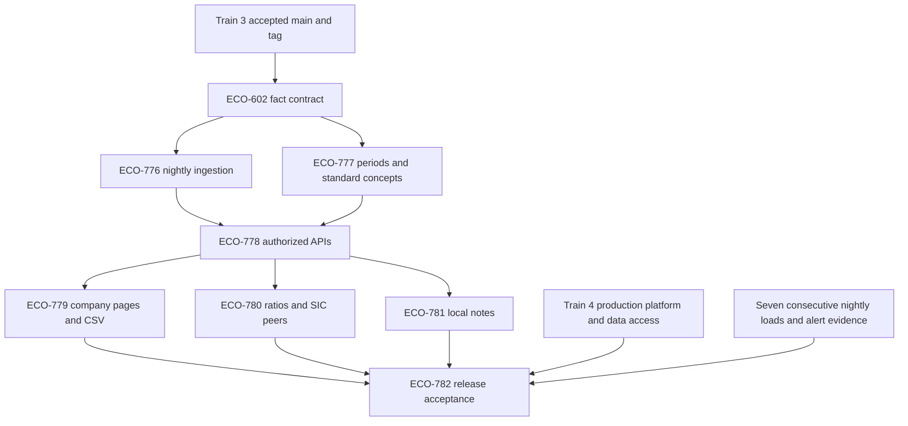

# Train 5 company research delivery

Train 5 delivers company research from SEC companyfacts: company lookup, three
normalized statements, financial history, CSV, ratios, SIC peers and local notes.
The release is v4.3.0. [ECO-8](https://linear.app/econgraph/issue/ECO-8) and
[ECO-116](https://linear.app/econgraph/issue/ECO-116) define the release scope.
Share prices and OAuth company MCP tools remain outside this train. Original
statement layouts, extension concepts and segments follow in Train 6.

## Dependencies and ownership

Ingestion and calculations can develop concurrently once their shared fact
contract is reviewed. API design can proceed against that contract; integration
must exercise persisted facts and real calculations. Pages, ratio presentation
and notes join the API contract before the complete research workflow runs.

The review stack is rooted at current `main` through the focused shared-reference
prerequisite [#773](https://github.com/EconGraph/econ-graph/pull/773). Each row below
is a separate pull request based on the preceding row's branch, so its diff contains
only that package. Merge in order, retargeting the next PR after its parent lands.

| Package | Branch | Review focus |
| --- | --- | --- |
| Shared references (Train 3) | `feat/train3-research-references` | Stable targets and legacy filing identity |
| Fact identity and schema | `stack/train5-fact-storage` | Decimal precision, revisions, Train 6 compatibility |
| Financial calculations | `stack/train5-calculations` | Actual periods, compatible inputs, missing data, provenance |
| Bulk ingestion | `stack/train5-ingestion` | Idempotency, recovery, archive bounds, freshness |
| Company APIs | `stack/train5-api` | Authorization, bounded queries, schema and data ownership |
| Local notes | `stack/train5-notes` | Durable anchors, legacy compatibility, owner permissions |
| Company pages | `stack/train5-ui` | Reachable controls, attribution, exact CSV, honest states |
| Release acceptance | `stack/train5-acceptance` | Independent fixtures, real workflow, operational evidence |

The original implementation worktrees remain available for reference. Independent
reviewers inspect package boundaries and final diffs. All pull requests require
passing CI for the latest commit and disposition of automated review comments.
No merge or production deployment is authorized by this coordination work.

## Baseline and integration gates

The review stack preserves current main and includes only the shared-reference
prerequisite from Train 3. It does not import the old provisional integration
baseline's observation-store, deployment, fixture or milestone changes. The
original aggregate PR is superseded by these focused package PRs.

This implementation ancestry does not accept Train 3's release. The seven Train 3
PRs [#772](https://github.com/EconGraph/econ-graph/pull/772) through
[#778](https://github.com/EconGraph/econ-graph/pull/778), accepted-main validation
and the immutable `train-3` tag remain release gates.

Train 4 remains an integration and production-release gate. Its independent data
service is absent from main, so the focused company-query boundary adapter
[#791](https://github.com/EconGraph/econ-graph/pull/791) remains separate from this
main-root stack until that service lands. Reconcile and validate that adapter
against the accepted Train 4 and Train 5 heads before release. Preserve the split
between app-owned notes and data-owned companies, filings and facts; never
introduce a cross-plane foreign key.

## Data and calculation contracts

Companyfacts has dedicated storage. Its subject identity preserves issuer CIK,
source taxonomy family, case-sensitive concept, raw unit and explicit instant or
duration endpoints. Filing accession identifies a revision. Filing fiscal labels
and calendar frames do not define the economic period. Numeric values stay exact;
conflicting values for the same subject and accession must not silently replace
evidence supporting a filed note.

Companyfacts taxonomy families are distinct from the filing-specific namespaces
used by the future parser. Any reference adapter must make that distinction
explicit. New ingestion metadata must not cause the existing raw-filing crawler
to skip a filing it has not downloaded.

Derived Q4 and TTM figures expose their input facts and revision cutoff. Missing
or incompatible periods produce an unavailable result. Per-share and weighted
average share figures cannot use naive subtraction or summation. Standardized
companyfacts statements must not claim to reproduce the original filing layout.

## Release acceptance

The release gate requires a signed-in researcher to find a company, inspect all
three statements and supported periods, chart any line, export exact CSV, inspect
ratios and peers, recognize restatements, and create and retrieve local notes.
Another user must not gain access to private notes. Every retained control must
perform its advertised action.

Acceptance also requires 20 fixed companies checked against their source facts,
the balance-sheet equation holding in at least 99 percent of checked periods,
freshness within a day, and seven consecutive successful nightly loads with
failure-alert evidence. Fixture runs and repeated executions in one day do not
substitute for the nightly evidence. Keep incomplete company pages gated until
the complete release bar is met.
