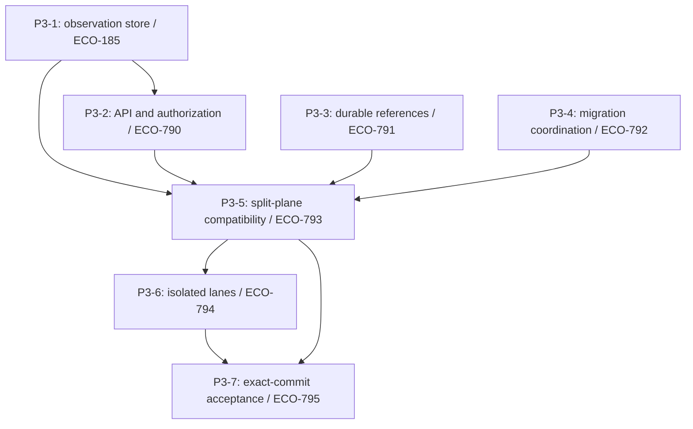

# Train 3 development baseline

Train 3 prepares a common executable baseline for independent storage, company
research and workspace development. Its implementation is reviewed on a feature
branch before any integration into main. The [specification](https://linear.app/econgraph/document/train-3-specification-parallel-development-foundations-5b8127e1adb3)
and [milestone](https://linear.app/econgraph/issue/ECO-789) define the eventual
acceptance requirements.

## Dependency graph

The store, identity and migration packages can be implemented independently.
API checks consume the store contract. The fixture suite joins those packages;
branch-isolation acceptance then exercises the same candidate in three lanes.
Milestone tooling can be developed alongside these packages, but its acceptance
gate runs only after their evidence exists for the exact candidate commit.

## Feature branch boundary

Feature-branch checks demonstrate implementation behavior; they do not mark the
main milestone complete. Passing unit tests or renderer tests does not substitute
for the split-plane database checks or the three-lane isolation proof. Keep
environment-dependent evidence and any unmet acceptance criteria visible in the
pull request.

Do not create the `train-3` tag or downstream branch cuts while this change is
under feature-branch review. Those are separate, authorized operations after
integration into main and exact-commit acceptance. Train 3 changes no product
version, release changelog, published image, deployment or migration baseline.

Later workstreams start from the accepted baseline: Train 4 covers
platform/storage, Train 5 covers company research, and Train 7 covers workspace
and machine access. Train 6 builds on Train 5. Shared contract changes should be
integrated before a dependent lane consumes them.
