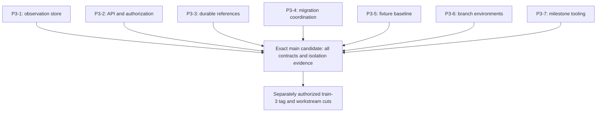

# Train 3 development baseline

Train 3 prepares a common executable baseline for independent storage, company
research and workspace development. Its implementation is split into seven
focused pull requests, each based on and targeting `main`. Each PR builds and
runs its own relevant checks without an unmerged sibling branch. The
[specification](https://linear.app/econgraph/document/train-3-specification-parallel-development-foundations-5b8127e1adb3)
and [milestone](https://linear.app/econgraph/issue/ECO-789) define the eventual
acceptance requirements.

## Independent pull requests

| Package | Branch; every PR targets `main` | Required contract coverage |
|---|---|---|
| P3-1 Observation store / ECO-185 | `feat/train3-observation-store` | `Backend Workspace Tests (all tests)` includes the observation contract and its explicitly enabled database cases. |
| P3-2 API and authorization / ECO-790 | `test/train3-data-api-contract` | `Backend Workspace Tests (all tests)` runs the data API contract against current behavior. |
| P3-3 Durable references / ECO-791 | `feat/train3-research-references` | `Backend Workspace Tests (all tests)` runs research-reference and filing-identity contracts. |
| P3-4 Migration coordination / ECO-792 | `ci/train3-migration-coordination` | `Backend Migration Validation Tests` includes the target-aware guard and actual disposable PostgreSQL rehearsal. |
| P3-5 Compatibility fixtures / ECO-793 | `test/train3-compatibility-fixtures` | `Split-plane compatibility` validates the isolated fixture baseline, deterministic identity, existing catalog authorization and core database behavior. |
| P3-6 Isolated branch environments / ECO-794 | `feat/train3-branch-environments` | `Deploy Manifest Rendering` runs the branch guards; real three-lane isolation evidence remains a separate acceptance requirement. |
| P3-7 Milestone and flag deadlines / ECO-795 | `chore/train3-milestone` | `Feature Flags Check` exercises milestone guards, flag checks and generated outputs. |

The fixture runner belongs to P3-5. It does not call tests or CLI options that
exist only in the unmerged store, API, reference or migration PRs. Those packages
own their executable contracts in the checks above. The common required CI
aggregates continue to apply to every PR; a green fixture workflow is not proof
that all Train 3 contracts passed.

## Acceptance dependency graph

Independent PR review does not remove the final acceptance dependencies. After
the package PRs merge, rerun their required checks against one exact main commit
and collect passing evidence for every P3-1 through P3-6 package plus all three
scratch workstreams. The [milestone helper](TRAIN_3_MILESTONE.md) requires the
workspace, migration, fixture and branch checks in addition to the repository's
required CI policy, verifies the package PRs are merged into the candidate's
ancestry with reviews complete, and requires every artifact to identify that
same candidate commit. Maintainers must inspect the linked semantic evidence.

## Development and publication boundary

Passing unit tests, fixture checks or renderer tests does not substitute for the
full store/API/reference/migration contracts or actual branch isolation proof.
Keep environment-dependent evidence and unmet acceptance criteria visible in the
relevant pull request. No individual PR marks the main milestone complete.

Do not create `train-3` or cut downstream branches while these changes are under
review. Publication is a separate authorized operation after integration into
main and exact-commit acceptance. Train 3 changes no product version, release
changelog, published image, deployment or migration baseline.

Later workstreams start from the accepted baseline: Train 4 covers
platform/storage, Train 5 covers company research, and Train 7 covers workspace
and machine access. Train 6 builds on Train 5. Shared contract changes should be
integrated into main before a dependent lane consumes them.
