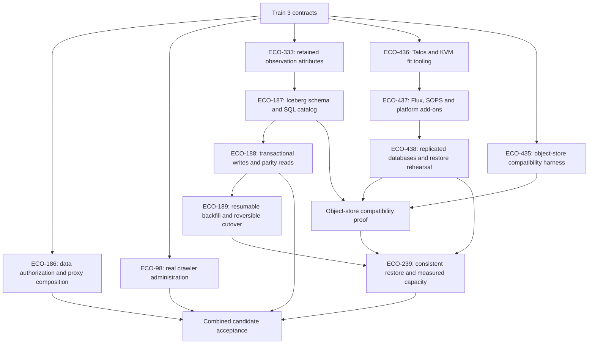

# Train 4 development

Train 4 combines the self-hosted platform, independent data access and Iceberg
observation storage described in [ECO-774](https://linear.app/econgraph/issue/ECO-774).
Development is stacked on `feat/train3`, starting at
`545826b04cf8950511ebfe8a767c26d3536810d7`. This feature-branch cut is explicitly
authorized before Train 3 main acceptance; it does not establish the `train-3`
milestone or change the eventual release prerequisites.

## Implementation dependencies

Independent implementation may proceed together. Each dependent package consumes
an integrated, tested contract; writing its harness early does not mean its live
acceptance gate has passed. The object-store probe precedes persistent host-store
selection. SQL catalog commits must share the existing fenced PostgreSQL crawl
transaction. Arrow Flight and later product trains are outside this scope.

## Worktree integration

The integration worktree is `.worktrees/train4` on `feat/train4`. Each lane has
its own branch and worktree, initially cut from the same Train 3 commit:

| Worktree suffix / branch suffix | Ownership |
| --- | --- |
| `train4-access` | API composition, direct data authorization, dev-readonly client |
| `train4-crawler` | Supported crawler operations, real state/logs, operator UI |
| `train4-attributes` | Observation attributes, provenance and source persistence |
| `train4-storage` | Iceberg capability probe, tables/catalog, store and atomic writes |
| `train4-objectstore` | Disposable object-store compatibility tests |
| `train4-talos` | Host preparation plans, OpenTofu/Talos and fit-test tooling |
| `train4-platform` | GitOps, add-ons, CloudNativePG and platform migration rehearsal |
| `train4-recovery` | Observation backfill/parity, cutover/rollback and recovery tools |

Lane branches use the `feat/` prefix. Integrate completed lane commits into
`feat/train4` in dependency order, validate their combined behavior, and target the
pull request at `feat/train3`. Dependencies can be cherry-picked into a downstream
lane after integration. Do not merge these changes into main or modify the Train 3
branch as part of this work.

## Safety and acceptance boundaries

Development changes no product version, release branch or milestone tag. Existing
production clusters, VMs, host bridges, object stores and databases remain under
their current deployment. Host preparation and migration tooling must default to
a reviewable plan; privileged application is a separate operational action.
Disposable tests use explicit ownership and bounded resources on the shared host.

Preserve arbitrary exact nullable observation values, all stored revisions and
attributes, stable series/dataset identities and user-authored data. Historical
attributes that were never stored remain absent. Legacy observation tables and
recovery copies are retained; destructive retirement is a separate reviewed gate.
No maintenance, cleanup or backup policy may silently delete promised history.

The release requires live proofs beyond rendering or unit tests: Talos rebuild and
upgrade/fit tests, node drain during release E2E, consistent database/catalog/object
restore, enforced audiences and read-only permissions, transactional writer failure
tests, migration parity and rollback preserving post-cutover writes. A missing KVM
device or unapproved host setup blocks the corresponding live proof; it must be
reported explicitly rather than replaced with a simulated success.

Persistent object-store service form, production capacity/latency targets and
recovery objectives require the recorded operator decisions described by the
delivery issues. Bounded development fixtures do not establish those targets.
